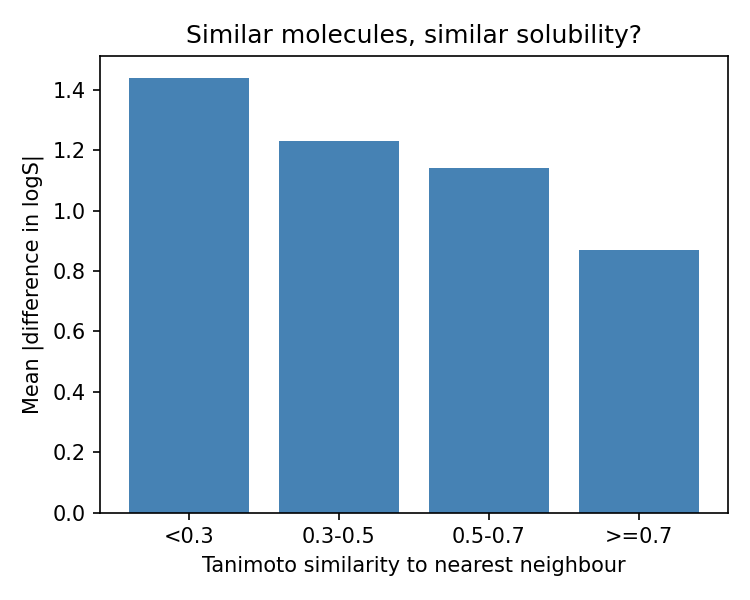

# Molecular Similarity Search

Finds the most similar molecules to a query using Morgan fingerprints (radius 2, 2048 bits) and Tanimoto similarity, and tests how well "similar molecules have similar solubility" holds on the Delaney dataset (1,128 molecules).

## What it does
1. Builds fingerprints for all molecules with RDKit.
2. Provides a `search(smiles, k)` function that returns the top-k most similar molecules with their Tanimoto score and measured logS (examples in the notebook: aspirin and ibuprofen).
3. Leave-one-out test: for each molecule, finds its nearest neighbour (excluding itself) and compares their logS values.

## Results
| Tanimoto similarity to nearest neighbour | Molecules | Mean absolute difference in logS |
|---|---|---|
| < 0.3 | 72 | 1.44 |
| 0.3 to 0.5 | 263 | 1.23 |
| 0.5 to 0.7 | 506 | 1.14 |
| >= 0.7 | 287 | 0.87 |

- The difference in logS shrinks as similarity rises, so similarity carries real information.
- Even at similarity >= 0.7 the average difference is 0.87 log units (about 7-fold in solubility), so fingerprint similarity alone is not a reliable predictor.
- The correlation between the nearest neighbour's logS and the true logS is r = 0.75.

## Limitations
- One dataset, one fingerprint type, one similarity metric.
- The lowest-similarity group is small (72 molecules), and differences between groups were not tested for statistical significance.
- This is a lookup test, not a trained prediction model.

## Files
`molecular_similarity_search.ipynb`, `similarity_vs_error.png`, `similarity_error_by_bin.csv`

## Tools
Python, pandas, NumPy, RDKit, Matplotlib, Google Colab

## Author
Suraj Gade | GitHub: surajgade17
